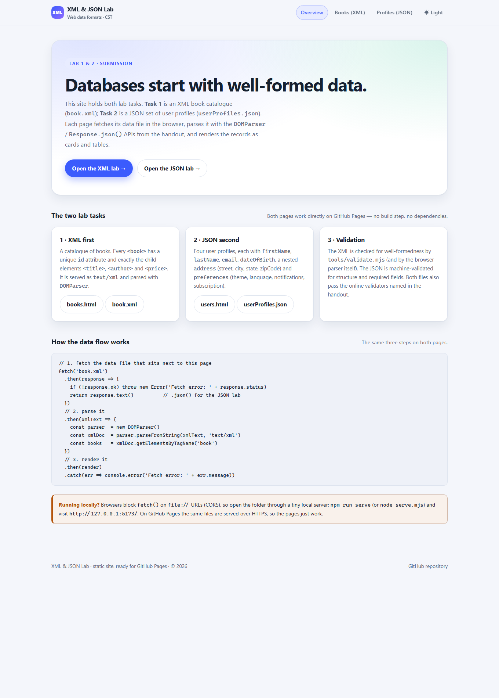
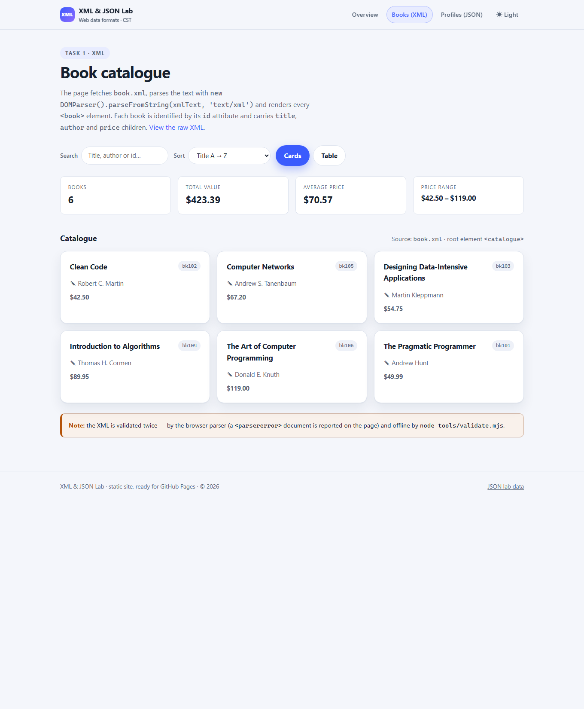
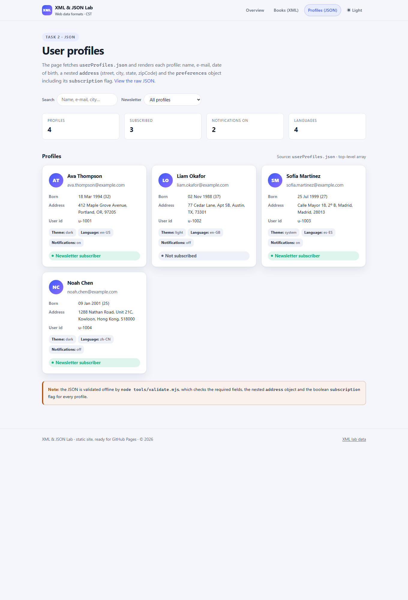

# XML & JSON Lab — Book Catalogue and User Profiles

Two lab tasks in one small static website. Both data files are fetched by the browser,
parsed with the APIs named in the handout, and rendered on the page. No frameworks,
no build step, no dependencies — the folder can be published on GitHub Pages as it is.

| Task | Data file | Page | What it shows |
| --- | --- | --- | --- |
| 1 · XML | `book.xml` | `books.html` | 6 books, each with an `id` attribute and `title` / `author` / `price` children |
| 2 · JSON | `userProfiles.json` | `users.html` | 4 profiles with `firstName`, `lastName`, `email`, `dateOfBirth`, nested `address`, `preferences` (incl. `subscription`) |

Rendered pages (captured from the running site): `screenshots/overview.png`,
`books-cards.png`, `books-table.png`, `users.png`, `users-dark.png`.





Shareable deep links: `books.html?view=table`, `books.html?sort=price-desc`,
`books.html?q=knuth`, and `?theme=dark` on any page.

---

## 1. Open it

**Locally (required — browsers block `fetch()` on `file://` URLs):**

```bash
npm run serve          # = node serve.mjs
# -> http://127.0.0.1:5173/
```

Any static server works just as well (`python -m http.server 5173`, VS Code Live Server, …).

**Online:** the same folder deployed to GitHub Pages (see §4). Pages are plain relative
paths, so the site works from a project page (`https://<user>.github.io/<repo>/`) without changes.

## 2. What is in the folder

```
lab-xml-json/
├── index.html            overview page, data-flow explanation
├── books.html            Task 1 page  — fetches book.xml, renders cards + table
├── users.html            Task 2 page  — fetches userProfiles.json, renders profile cards
├── book.xml              Task 1 data  — <catalogue> root, 6 <book> elements
├── userProfiles.json     Task 2 data  — top-level array of 4 profiles
├── css/styles.css        one stylesheet, light + dark themes, responsive
├── js/app.js             shared: theme toggle, active nav link, year stamp
├── js/books.js           XML: fetch → DOMParser → normalise → render/filter/sort
├── js/users.js           JSON: fetch → Response.json() → normalise → render/filter
├── serve.mjs             tiny static server for local preview (correct MIME types)
├── tools/validate.mjs    offline validator for book.xml and userProfiles.json
├── tools/selftest.mjs    self-test proving the XML checker rejects broken documents
├── package.json          npm scripts: serve / validate
├── .nojekyll             tells GitHub Pages not to run Jekyll
└── screenshots/          rendered captures of every page (light + dark)
```

## 3. The two lab tasks

### Task 1 — XML book catalogue (`book.xml`)

```xml
<?xml version="1.0" encoding="UTF-8"?>
<catalogue>
  <book id="bk101">
    <title>The Pragmatic Programmer</title>
    <author>Andrew Hunt</author>
    <price>49.99</price>
  </book>
  …
</catalogue>
```

* six books, every `id` unique (`bk101` … `bk106`);
* each book contains exactly the required children `title`, `author`, `price`;
* the file is well-formed (no unescaped `<` or `&`, all tags balanced, one root element).

### Task 2 — JSON user profiles (`userProfiles.json`)

Top-level array of four profiles. Each profile:

```json
{
  "id": "u-1001",
  "firstName": "Ava",
  "lastName": "Thompson",
  "email": "ava.thompson@example.com",
  "dateOfBirth": "1994-03-18",
  "address": {
    "street": "412 Maple Grove Avenue",
    "city": "Portland",
    "state": "OR",
    "zipCode": "97205"
  },
  "preferences": {
    "theme": "dark",
    "language": "en-US",
    "notifications": true,
    "subscription": true
  }
}
```

The extension step from the handout is included: `address` (street, city, state, zipCode)
was added to every profile and `subscription` (boolean) was added to `preferences`.

### Rendering

`books.html` uses the exact pattern from the instructions:

```js
const parser = new DOMParser();
const xmlDoc = parser.parseFromString(xmlText, 'text/xml');
```

`users.html` uses the `fetch(...).then(response => …).then(json => …).catch(…)` shape shown
in the handout. Both pages:

* report a failed request (`Fetch error: <status>`) instead of failing silently;
* report an XML `parsererror` / invalid JSON on the page;
* render each record's required fields (title/author/price, and
  firstName/lastName/email/dateOfBirth plus address and preferences);
* ship small extras: live search, sorting, card/table views, statistics, light/dark theme.

## 4. Publish on GitHub Pages

This submission is already deployed from the `main` branch of
[`Tengdaiyuan/lab4`](https://github.com/Tengdaiyuan/lab4):

```
https://tengdaiyuan.github.io/lab4/
```

To publish the same folder in another repository:

```bash
cd lab-xml-json
git init -b main
git add .
git commit -m "XML & JSON lab"
git remote add origin https://github.com/<your-user>/<your-repo>.git
git push -u origin main
```

Then, in the repository: **Settings → Pages → Build and deployment**

* **Source: Deploy from a branch** → Branch `main`, folder `/ (root)` → **Save**.

Wait for the deployment (usually a minute) and open:

```
https://<your-user>.github.io/<your-repo>/
```

Use that URL as the submitted link (add `/books.html` and `/users.html` if the grader wants
each lab page separately). If the repository is published as a *user* page
(`<your-user>.github.io`), the root URL is the site.

> Keep `book.xml` and `userProfiles.json` in the same folder as the HTML pages — the pages
> fetch them with relative paths.
>
> The repository deliberately contains no Pages *workflow*: with the Pages source set to a
> branch, an Actions-based deploy on every push would only add failing runs.

## 5. Validation

Offline, reproducible check of both data files:

```bash
npm run validate
# or: node tools/validate.mjs
```

It reports:

* XML well-formedness — balanced tags, single root element, quoted/unique attributes,
  legal entity references, declaration and comment placement — implemented in
  `tools/validate.mjs` with no third-party parser;
* the structure required by the handout: `id` attribute, `title`, `author`, `price`,
  unique ids, numeric prices;
* JSON structure — required fields, e-mail shape, `YYYY-MM-DD` birth dates, nested
  `address`, `preferences` with boolean `notifications` and `subscription`, unique
  e-mails and ids.

`node tools/selftest.mjs` runs 17 positive/negative cases against the XML checker so the
"OK" result is meaningful.

The same files can be pasted into the online validators named in the handout (XML Validation
and JSON Formatter & Validator); the local validator above enforces the same rules, so they
should pass unchanged. The browser parser is a third opinion: the pages display a
`<parsererror>` message if the XML is malformed, and the JSON is only rendered after a
successful `response.json()`.

## 6. Notes / details worth a look

* `serve.mjs` sets `text/xml` for `.xml` and `application/json` for `.json`, and refuses to
  serve paths outside the project folder.
* On `file://` the pages explain the CORS limitation in the error banner instead of showing
  a blank area.
* `users.js` accepts a bare array as well as an object wrapping `userProfiles` / `profiles`,
  so the data file can grow without breaking the page.
* No external fonts, icons or CDN scripts: the submission link works offline and cannot
  break because a third-party host is down.

---

## 中文说明

* 这是 XML 实验（`book.xml`）与 JSON 实验（`userProfiles.json`）的合并提交，两个页面分别用
  `fetch` 取数据，按讲义要求用 `DOMParser` / `response.json()` 解析后渲染。
* 本地预览必须先起一个静态服务器（浏览器禁止 `file://` 下的 `fetch`）：
  `npm run serve`，然后打开 `http://127.0.0.1:5173/`。
* 数据校验：`npm run validate`，全部通过会打印 `All checks passed.`
  自检脚本：`node tools/selftest.mjs`。
* 发布到 GitHub Pages 后，把仓库 Pages 地址（`https://<用户名>.github.io/<仓库名>/`）作为
  作业链接提交；两个实验页面分别是 `books.html` 与 `users.html`。
* 本次已部署：<https://tengdaiyuan.github.io/lab4/>（仓库 `Tengdaiyuan/lab4`，main 分支根目录）。
